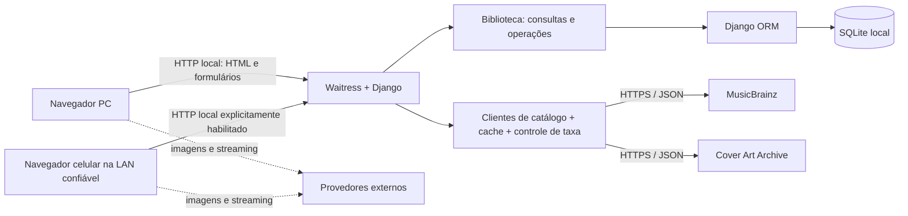

# Arquitetura — biblioteca pessoal de álbuns

**Data:** 14/10/2026.

**Estado:** arquitetura, ADRs e resoluções P-01–09 aprovados em 14/10/2026 por delegação do usuário; prontos para implementação do MVP local.

**Fontes:** [PROJECT_SCOPE.md](PROJECT_SCOPE.md) e [REQUIREMENTS.md](REQUIREMENTS.md).

## 1. Direção arquitetural e limites

Adotar um **monólito Django com renderização de HTML no servidor**, um único aplicativo de negócio `library` e SQLite em disco local. O navegador do PC e o do celular acessam o mesmo processo e banco. Chamadas de catálogo ficam no servidor; imagens remotas e links de streaming são abertos pelo navegador.

Essa solução atende ao uso pessoal, ao volume de referência de 1.000 álbuns e ao acesso pela rede local sem introduzir uma API, aplicação frontend separada ou infraestrutura de filas. A confirmação da meta de desempenho depende dos testes descritos adiante.

O repositório analisado contém os documentos de definição, sem aplicação implementada. A estrutura, modelos, bibliotecas e parâmetros abaixo foram aprovados por delegação do usuário em 14/10/2026, preservando as decisões E/U de REQUIREMENTS.md. A aprovação abrange as decisões T, os ADRs e as resoluções P-01–09 da seção 11, incorporadas à seção 10 dos requisitos. O contato real da integração, o ambiente de medição e o destino de backup devem ser preenchidos antes das respectivas atividades; não bloqueiam a implementação. Esta revisão realiza somente a aprovação documental.



Publicação, autenticação, PostgreSQL, múltiplos usuários e sincronização com streaming continuam fora do MVP. O procedimento de backup local está incluído. Sem internet, os metadados salvos, pesquisa e sorteio continuam funcionando; imagens remotas e streaming não têm garantia de disponibilidade.

## 2. Tecnologias e bibliotecas

| Escolha aprovada | Responsabilidade e justificativa |
| --- | --- |
| Python 3.13, no patch de manutenção atualizado | Uma linguagem para servidor, integrações e testes. É compatível com Django 5.2; não há necessidade funcional de uma versão mais nova. Usar `venv` e `pip` evita ferramenta adicional de ambiente. |
| Django 5.2 LTS, no patch de segurança atualizado | Já previsto no escopo. Reúne ORM, migrações, formulários, templates, CSRF, validação e testes. A linha LTS favorece manutenção previsível. [Compatibilidade e suporte oficiais](https://docs.djangoproject.com/en/5.2/releases/5.2/). |
| SQLite, via backend do Django | Já previsto no escopo. Banco relacional em arquivo, adequado ao uso local e às associações entre álbuns e artistas; não requer serviço independente. |
| Django Templates, Forms e formsets | HTML renderizado no servidor, validação de campos e conjuntos de artistas/links com os recursos do framework. Mantém um único fluxo de validação para cadastro manual e dados externos revisados. |
| HTML semântico, CSS próprio e JavaScript pequeno | Layout responsivo com Grid/Flexbox, rótulos, foco e mensagens de erro. JavaScript somente para melhoria de interação, linhas de formulário e fallback de imagem; sem framework frontend, build Node ou dependência de CDN. |
| HTTPX síncrono | Um cliente para as duas APIs, com verificação TLS, streaming de respostas, timeouts por etapa e transporte substituível nos testes. O uso síncrono acompanha WSGI e evita misturar paradigmas. Timeout de leitura não equivale a prazo total; este precisa de controle adicional. [Documentação de timeouts](https://www.python-httpx.org/advanced/timeouts/). |
| Waitress, um processo e quatro threads | Servidor WSGI para execução cotidiana local e LAN, evitando depender de `runserver` nessa operação. Threads permitem que consultas externas não ocupem todo o atendimento local. O processo único também delimita os locks e o cache em memória. [Opções oficiais](https://docs.pylonsproject.org/projects/waitress/en/latest/arguments.html). |
| WhiteNoise | Servir CSS, JavaScript e a imagem padrão com `DEBUG=False`, sem Nginx adicional. Somente arquivos estáticos coletados, sem banco, backups ou arquivos privados. [Integração oficial](https://whitenoise.readthedocs.io/en/stable/django.html). |
| `unittest`, `unittest.mock` e test runner do Django | Testes de regras, formulários, rotas e persistência sem pytest ou plugins adicionais. |
| Playwright para Python, apenas em desenvolvimento/teste | Automatizar os fluxos de navegador que precisam demonstrar funcionamento conjunto, inclusive JavaScript de capas e responsividade. Um teste em celular real complementa a emulação; não é dependência de execução. [Documentação oficial](https://playwright.dev/python/docs/library). |

Usar a biblioteca padrão para Unicode (`unicodedata`), escolha aleatória (`random`), locks e relógio monotônico (`threading`, `time`), UUIDs e inspeção de backup (`sqlite3`). Não adicionar bibliotecas para essas tarefas.

Fixar versões exatas das dependências diretas e transitivas em arquivos reproduzíveis de execução e desenvolvimento, no momento da implementação, após verificar compatibilidade. Registrar versões de Python e SQLite no diagnóstico local. Não copiar números de patch deste documento para uma instalação futura sem verificar atualizações de segurança.

## 3. Estrutura de diretórios aprovada

A árvore descreve arquivos futuros a criar durante a implementação do MVP aprovado.

```text
music-library-app/
├── PROJECT_SCOPE.md
├── REQUIREMENTS.md
├── ARCHITECTURE.md
├── README.md                      # instalação, execução, configuração e verificações
├── requirements.txt               # dependências de execução fixadas
├── requirements-dev.txt           # dependências de teste fixadas
├── .env.example                   # nomes e exemplos; sem segredos reais
├── .gitignore
├── manage.py
├── config/
│   ├── __init__.py
│   ├── settings.py                # configuração explícita por ambiente
│   ├── urls.py
│   └── wsgi.py
├── library/
│   ├── __init__.py
│   ├── apps.py
│   ├── models.py                  # entidades e restrições persistidas
│   ├── forms.py                   # formulários e formsets
│   ├── views.py                   # adaptação HTTP
│   ├── urls.py
│   ├── services.py                # gravações transacionais e sorteio
│   ├── queries.py                 # consultas locais compartilhadas
│   ├── validation.py              # normalização, datas e URLs
│   ├── integrations/
│   │   ├── __init__.py
│   │   ├── musicbrainz.py
│   │   ├── cover_art.py
│   │   └── transport.py           # limites, cache, HTTP e tradução de falhas
│   ├── migrations/
│   ├── templates/library/         # base, biblioteca, artistas, detalhes,
│   │                             # formulário, busca externa, confirmação e erros
│   ├── static/library/
│   │   ├── app.css
│   │   ├── app.js
│   │   └── cover-placeholder.svg
│   ├── management/commands/       # backup/restore local
│   └── tests/
│       ├── test_validation.py
│       ├── test_writes.py
│       ├── test_queries.py
│       ├── test_draw.py
│       ├── test_integrations.py
│       ├── test_views.py
│       ├── test_concurrency.py
│       ├── test_backup.py
│       ├── test_browser.py
│       └── fixtures/             # respostas externas mínimas e casos controlados
├── docs/
│   ├── operations.md             # PC/LAN, backup, restauração e diagnóstico
│   └── acceptance.md             # ambiente, dataset, RF/CA, tempos e resultados
└── var/                          # privado, ignorado pelo Git
    ├── library.sqlite3
    ├── backups/
    └── static/                   # saída de collectstatic; único conteúdo público de var
```

Um único `settings.py` com opções explícitas é suficiente. Não criar agora árvore de configurações de nuvem, pacotes `core/common`, repositórios genéricos ou interfaces para implementações hipotéticas. Separar módulos maiores somente quando seu tamanho e uso justificarem.

## 4. Responsabilidades e dependências internas

| Componente | Responsabilidade | Limite |
| --- | --- | --- |
| URLs e views | Receber GET/POST, validar formulários, chamar operações, renderizar e redirecionar. | Não concentrar regras de duplicidade nem chamadas HTTP externas dispersas. |
| Forms/formsets | Validar estrutura de entrada, campo obrigatório, URL, data e itens completos; reapresentar valores e erros. | Não salvar parcialmente álbum, artistas ou links durante a validação. |
| `validation.py` | Funções puras para normalização, datas e protocolos; compartilhadas por formulários e operações. | Sem dependência de HTTP; ano corrente recebido do relógio local configurado. |
| `services.py` | Criar, editar, trocar edição, remover e sortear; autorizar transição de estado pelo fluxo revisado; coordenar transações, revisão e conflito. | Somente esse caminho faz gravações de negócio. Não usar signals para efeitos escondidos. |
| `queries.py` | Compor buscas locais, candidatos a duplicado, artistas visíveis e conjuntos elegíveis; controlar prefetch e ausência de repetição. | Usa ORM diretamente, sem repository/DAO intermediário. |
| Models e migrações | Dados relacionais, chaves, índices, referências e restrições estáveis. | Não chamar APIs em `save()`, propriedades ou renderização. |
| Integrações | Buscar, limitar, validar estrutura externa e traduzir JSON em sugestões de campos reconhecidos. | Não salvar entidades de negócio nem decidir identidade por conta própria. |
| Templates e estáticos | Apresentação, navegação, acessibilidade e imagens alternativas. | Não conter regras de identificação, consulta a catálogo ou sorteio. |
| Comandos operacionais | Backup consistente, inspeção e restauração explícita. | Não expostos como endpoints web. |

As dependências são funções e objetos de dados simples em Python, dentro do mesmo processo. Views usam services/queries; services/queries usam models e validação. Views chamam as integrações na etapa de pesquisa/revisão, **fora** das transações de gravação. Não é necessário um barramento de eventos, container de injeção ou hierarquia de interfaces. Cliente HTTP, relógio e fonte aleatória podem ser substituídos pontualmente para testes.

## 5. Comunicação e fluxos

### 5.1 Navegador e servidor

HTTP com páginas HTML e formulários. Leituras e pesquisa usam GET; gravações usam POST com CSRF. Após gravação bem-sucedida, aplicar Post/Redirect/Get. GET de confirmação de exclusão apenas mostra a página; o POST confirmado remove. Sorteio pode usar POST e redirecionar aos detalhes, evitando sorteios por prefetch de links, embora não grave histórico.

Rotas previstas: biblioteca `/`, artistas `/artists/`, artista `/artists/<id>/`, álbum `/albums/<id>/`, cadastro `/albums/new/`, edição, confirmação de remoção, busca externa `/catalog/search/`, revisão de edição e sorteios global/por artista. São rotas internas de páginas, sem API JSON pública. Identificadores são locais; URLs externas não viram rotas locais.

Registrar artista inexistente e álbum inexistente como 404. Formulário inválido volta com erros; conflito de revisão ou persistência tem mensagem própria, sem mensagem de sucesso. Não exigir uma família de códigos HTTP para cada erro de campo.

### 5.2 Cadastro manual, busca e troca de edição

1. Cadastro manual abre diretamente o formulário e nunca exige catálogo.
2. Busca externa consulta cache e MusicBrainz. O usuário escolhe uma `release`, não uma edição escolhida automaticamente pela aplicação.
3. Obter detalhes da edição e, quando disponível, dados do `release-group` para sugerir lançamento original. `release.date` é data de edição; não pode preencher o original desconhecido. Dados do catálogo continuam sujeitos à revisão. [Modelo de consulta do MusicBrainz](https://musicbrainz.org/doc/MusicBrainz_API).
4. Consultar metadados do Cover Art Archive pela `release` selecionada e obter referência de miniatura frontal, quando existente. Sem capa, conservar o fluxo com imagem padrão. Não consultar o catálogo ao abrir uma biblioteca já salva. [API do Cover Art Archive](https://musicbrainz.org/doc/Cover_Art_Archive/API).
5. Renderizar formulário revisável com título, artistas, original, edição e capa. Campos de apresentação da edição são definidos em P-01. Não persistir álbum provisório para montar a revisão.
6. Transportar os campos editáveis no formulário; metadados de proveniência podem ser assinados com o mecanismo do Django para detectar adulteração. Revalidar tudo no servidor, inclusive IDs de artistas, MBIDs e a revisão do registro. Expiração da proveniência não deve apagar os dados digitados; oferecer revisão ou cadastro manual. Não depender de cache externo válido para salvar um formulário já revisado.
7. No POST final, validar novamente candidatos a duplicado e conflito, então gravar tudo em transação curta. Falha anterior à confirmação conserva a coleção.

Troca de edição usa operação específica sobre o álbum existente. Carrega os links persistidos no servidor e os conserva integralmente; não aceita substituí-los por campos omitidos no formulário da troca. Mantém a capa manual, salvo instrução explícita de remover/substituir, e revisa a capa automática da nova edição. Não reutiliza cegamente um `ModelForm.save()` que sobrescreva os campos preservados.

### 5.3 Consulta e sorteio locais

Listagem/pesquisa consultam apenas SQLite. Decisão: paginação de 50 álbuns, busca parcial da chave normalizada de título ou artista, consulta vazia mostra biblioteca e ordenação por título normalizado/ID. A página de artista usa a mesma consulta restrita ao artista. Usar `Exists` ou `distinct` para não repetir álbuns em colaborações; prefetch de artistas evita N+1. Detalhes carregam links e artistas em consultas limitadas. Busca parcial por substring pode varrer o conjunto; isso é aceitável como hipótese a medir para 1.000 álbuns, sem prometer que um índice B-tree acelera `%termo%`.

Para sortear, materializar **uma única consulta** com um item por álbum elegível, trazendo os campos necessários ao resultado, e escolher uniformemente um índice com `random.choice`. O conjunto é o snapshot dessa consulta. Evita consulta de contagem seguida de offset em um conjunto que pode mudar. Complexidade O(N), adequada ao volume proposto; não usar `ORDER BY RANDOM()` nem sortear IDs entre mínimo e máximo, pois lacunas invalidam esse último método.

Não existe exclusão do último sorteado, peso por artista, filtro implícito pela busca ou dependência de capa/links. Conjunto vazio produz orientação contextual. Se o álbum for removido depois da seleção, o redirecionamento pode resultar em 404 tratado; isso não muda a elegibilidade no instante do sorteio.

## 6. Persistência e integridade

### 6.1 Modelo relacional aprovado

| Entidade | Campos/relações e regras |
| --- | --- |
| `Album` | PK local inteira; título de exibição; chave normalizada indexada; original opcional; MBID da `release` escolhida opcional; URL manual e URL automática de capa separadas; Spotify opcional; revisão inteira; token único de criação. Campos adicionais de original, edição e desambiguação seguem P-01/P-03. |
| `Artist` | PK local inteira; nome de exibição e chave normalizada indexada. Decisão P-02: MBID confirmado opcional e descrição curta de desambiguação. Nome normalizado não é único. |
| `AlbumArtist` | FKs de álbum e artista, unicidade do par. Exclusão do álbum remove vínculo; artista não é excluído em cascata. Decisão: posição para preservar apresentação do crédito, sem influenciar comparação do conjunto nem sorteio. |
| `StreamingLink` | FK do álbum, nome da plataforma, URL e posição de apresentação. Exclusão do álbum remove links. Campo Spotify fica no álbum para corresponder diretamente ao formulário previsto; links adicionais ficam nesta tabela. |

Não criar tabela de faixas, coleções de usuário, estado de escuta ou versões históricas de edição. A edição escolhida cabe no álbum; trocá-la não requer uma entidade de histórico. Não persistir JSON bruto do catálogo como fonte de verdade. O `release-group` pode ser guardado como proveniência opcional conforme P-01; não será chave única nem prova definitiva de identidade.

**Normalização:** NFD → casefold Unicode → NFD → remoção de marcas combinantes e de todo whitespace Unicode. Preservar pontuação e grafia original em campos distintos. Rejeitar chave vazia. Aplicar a mesma função à consulta local; não confiar em `NOCASE`/`icontains` do SQLite para implementar toda a regra Unicode. Atualizações de título/nome devem recomputar a chave na operação de escrita; edição direta por admin, signals ou `QuerySet.update()` fora desse caminho não será um fluxo suportado do MVP. Uma mudança futura do algoritmo exige migração e reconstrução das chaves.

**Datas, conforme P-03 aprovada:** três componentes anuláveis (ano, mês, dia); precisão derivada dos componentes presentes, sem datas artificiais como 1º de janeiro. Ausência de ano exige ausência dos demais; dia exige mês; validar calendário e limite corrente. Repetir a representação para edição conforme armazenamento aprovado. O ano principal sempre vem do original. Não criar uma coluna de precisão redundante que possa contradizer os componentes.

**Restrições:** FKs, unicidade de associação, token de criação único e componentes de data estruturalmente consistentes no banco; texto, protocolo, calendário, ano corrente e pelo menos um artista validados pelo serviço. O requisito de ao menos uma linha relacionada exige a operação transacional: uma constraint simples de coluna não o resolve. Nenhum `UNIQUE(título, artistas, data)` será criado; isso bloquearia homônimos legítimos e ignoraria datas incompletas. Confirmar identidade de artista antes de associar; chaves equivalentes apenas geram candidatos.

### 6.2 Gravação e concorrência

Mesmo com um proprietário, duas abas ou PC e celular podem gravar simultaneamente.

- Usar SQLite em disco local, um servidor ativo para a mesma biblioteca e transações de escrita `atomic` curtas em modo **IMMEDIATE**. Desativar `ATOMIC_REQUESTS`: buscas externas e renderização não seguram a trava do banco. A configuração de modo existe no backend Django; SQLite continua limitado a um escritor por vez. [Documentação do backend](https://docs.djangoproject.com/en/5.2/ref/databases/#sqlite-notes).
- Entrar na transação antes de repetir a consulta de duplicados; só depois criar artistas, álbum, vínculos e links. Todas as gravações de negócio seguem esse caminho. Uma prévia fora da transação não protege contra corrida.
- A serialização evita que duas criações deixem de observar uma à outra. A regra final de identidade segue as decisões aprovadas em P-01/P-02/P-03: ambiguidade gera revisão, sem fusão ou liberação automática. A arquitetura não promete deduplicar fatos que os dados não permitem identificar.
- Emitir token de criação assinado pelo servidor e persistir sua identidade única no álbum. Reenvio da mesma criação retorna o resultado já confirmado; se o conteúdo mudou, indicar revisão do existente. Isso cobre duplo clique/reenvio, além do Post/Redirect/Get. Tokens distintos continuam sujeitos à verificação de duplicidade.
- Propor controle otimista por `revision`: edição, troca e remoção submetem a revisão carregada; dentro da transação, conferir a revisão atual e incrementá-la na alteração. Formulário antigo recebe conflito e acesso à versão atual, preservando os dados submetidos para revisão. Não sobrescrever silenciosamente a edição feita no outro dispositivo.
- Timeout de banco aprovado de 3 segundos, sem laço automático de reenvio de operações. Erro de lock, disco cheio ou falha intermediária faz rollback e mensagem de falha. Não usar `select_for_update()` como garantia no SQLite.

Manter o journal padrão inicialmente, sem WAL obrigatório nem ajustes de durabilidade para ganhar tempo. Avaliar WAL apenas se medição indicar contenção de leitura e escrita; se adotado, revisar backup e arquivos auxiliares. Não guardar o banco em compartilhamento de rede ou pasta com sincronização concorrente. Crescimento de escritores/volume exige reavaliar PostgreSQL.

### 6.3 Backup e restauração

Decisão P-09: comandos locais documentados, sem botão web, agenda ou nuvem. Criar backup em arquivo temporário pela API `sqlite3.Connection.backup`, validar a cópia e publicar o arquivo final só após sucesso. Não copiar apenas o arquivo aberto com `cp`. A API permite cópia consistente mesmo com acesso concorrente. [API de backup do Python](https://docs.python.org/3.13/library/sqlite3.html#sqlite3.Connection.backup).

Registrar junto da cópia a versão da aplicação/esquema, data e instruções de recuperação. O banco guarda metadados, associações, URLs e revisões; cache em memória é descartável. Com a decisão de capas remotas, não existem imagens particulares a copiar e o backup não garante preservação do conteúdo remoto. Armazenamento local de imagens não integra o MVP aprovado (P-07).

Para restaurar: parar o servidor; validar arquivo, integridade SQLite, FKs e compatibilidade de migrações em ambiente temporário; preservar cópia recuperável do banco atual; substituir apenas depois dessas etapas e testar antes de reabrir na LAN. Recusar backup incompatível em vez de migrar silenciosamente durante restauração. Recuperação de versão antiga deve usar procedimento explícito com versão compatível e posterior migração testada. Falha não remove a cópia anterior. Documentar permissões de arquivos, destino escolhido e teste separado com APIs bloqueadas.

## 7. Integrações: cache, taxa e orçamento de recursos

Todas as chamadas MusicBrainz, inclusive detalhes de edição e `release-group`, passam por **um único controlador por processo**. A política do fornecedor envolve aplicação e IP; o servidor exige User-Agent com nome, versão e contato real antes de habilitar chamadas. Outros programas usando o mesmo IP podem consumir o limite compartilhado. [Política oficial](https://musicbrainz.org/doc/MusicBrainz_API/Rate_Limiting).

Configuração aprovada P-06:

| Parâmetro | Valor inicial aprovado e razão |
| --- | --- |
| Cadência MusicBrainz | Pelo menos 1,1 segundo entre inícios, pelo relógio monotônico, e uma chamada em andamento por vez. Margem conservadora em relação a 1/s. |
| Admissão externa | No máximo um fluxo de catálogo ativo; novas consultas externas recebem estado de ocupado/repetir, em vez de fila ilimitada. Cache hit é servido imediatamente. Isso reserva capacidade de threads para leitura/escrita local. |
| Prazo de um fluxo de catálogo | 15 segundos incluindo espera por taxa e chamadas sequenciais; interromper enriquecimentos opcionais quando o orçamento acabar. Não consultar detalhes de cada resultado de uma página. |
| Timeout HTTP | Conexão 2 s; leitura/escrita 3 s por etapa; pool 1 s; prazo total por chamada 5 s, respeitando também o saldo do fluxo. Verificar prazo durante leitura incremental e limitar cada etapa ao saldo, pois timeout de leitura sozinho não limita respostas lentas contínuas. |
| Resposta | Até 2 MiB de JSON descomprimido por chamada, inclusive quando Content-Length faltar ou estiver incorreto; leitura incremental, validação de tipo e estrutura. Não baixar imagens binárias no servidor. |
| Cache | Em memória, protegido contra concorrência: até 200 entradas e 16 MiB de conteúdo total; resultados bem-sucedidos por 15 min, resposta realmente vazia por 60 s. Chave inclui fornecedor, operação e parâmetros/página. Não guardar exceção como resultado vazio. |
| Retentativas | Nenhuma automática. Em 429/503, informar falha e aplicar pausa compartilhada por fornecedor; respeitar Retry-After válido, com 30 s como valor inicial aprovado quando ausente. Nova tentativa manual continua sujeita à pausa/taxa. |
| Cover Art Archive | Controlador separado, uma chamada em andamento e intervalo conservador de 1,1 s por escolha local, sem afirmar que esse seja o limite oficial do fornecedor. Mesmos limites de tamanho/tempo e fallback. |

Implementar cache/controle dentro de `transport.py`, com locks simples; não depender de operações `get`/`set` separadas como trava. Reconsultar cache após adquirir admissão evita chamadas duplicadas. Não manter trava de banco enquanto espera rede. O orçamento externo e a admissão impedem quatro pesquisas lentas de ocupar simultaneamente as quatro threads do servidor proposto.

No MVP, cache e limitadores não são distribuídos. Reinício esvazia cache e deve impor espera inicial de pelo menos 1,1 s antes da primeira chamada. Executar vários processos/instâncias rompe essa garantia e não é uma configuração suportada; se passar a ser necessário, o controle precisa de coordenação entre processos, além de reavaliar banco e servidor.

## 8. Segurança e operação local

As medidas são decisões técnicas aprovadas correspondentes a SEG-01–10; não acrescentam contas de usuário.

| Risco | Medida aprovada e limite |
| --- | --- |
| Exposição da biblioteca na rede | Escuta padrão em `127.0.0.1`. LAN exige optar explicitamente pelo IP local de escuta, configurar `ALLOWED_HOSTS` com hosts/IPs específicos e restringir porta pela rede/firewall. Sem wildcard, roteamento de porta ou túnel. Qualquer dispositivo com acesso autorizado à porta pode ler e alterar a coleção, pois não há autenticação. |
| Transporte LAN em HTTP | Aceitável apenas na rede confiável prevista, sujeito a observação/alteração de tráfego por participantes da rede. Não reutilizar essa configuração para publicação. PC e celular precisam estar na mesma rede com comunicação permitida e servidor ativo. |
| CSRF e alteração por GET | Middleware CSRF ativo; POST nas gravações e na confirmação; não desabilitar proteção para corrigir problemas de origem. Usar a origem real de acesso; se necessária configuração adicional de origem, especificá-la sem curingas. |
| XSS, SQL injection e dados externos | Autoescape de templates, ORM parametrizado, nenhuma aplicação indiscriminada de `safe`, validação do servidor para todos os caminhos. Não renderizar HTML retornado pelo catálogo. |
| URLs perigosas | Aceitar apenas HTTP/HTTPS, com limites, sem credenciais embutidas; rejeitar `javascript:`, `data:`, `file:` e demais esquemas. Política Spotify está aprovada em P-04. Abrir nova aba com `rel="noopener noreferrer"`. Não realizar verificação automática dos links no servidor. |
| SSRF em catálogos/redirecionamentos | Construir URLs a partir de origens HTTPS fixas e MBIDs validados. Desabilitar redirects automáticos: rejeitar ou permitir apenas saltos HTTPS para hosts explicitamente documentados da integração, nunca destino arbitrário ou privado. URLs de imagem retornadas não são requisitadas pelo servidor. Validar TLS e não aceitar configuração que o desative. |
| Capa manual e rastreamento | Carregar imagem no navegador, sem proxy/download do servidor. Não há fetch de URL manual pelo Django. Requisições revelam IP e acesso ao provedor; usar `referrerpolicy="no-referrer"`, dimensões fixas e lazy loading nas listas. HTTP pode ser bloqueado como mixed content numa futura publicação HTTPS; isso será reavaliado nessa etapa. |
| Imagem quebrada/hostil | Exibir somente como `img`, sem incorporar HTML ou SVG remoto como documento. Falha troca uma vez pela imagem padrão, preserva URL manual e não tenta automática no lugar da manual quebrada. Se a padrão falhar, texto continua acessível, sem loop. Tamanho binário da imagem remota no navegador não é controlado pelo limite JSON; miniaturas e carregamento preguiçoso mitigam, sem garantia contra provedor malicioso. |
| Vazamento operacional | `DEBUG=False` na execução cotidiana, `SECRET_KEY` fora do Git, logs sem tokens, consultas pessoais completas ou respostas brutas. Banco/backups fora de caminhos estáticos; WhiteNoise serve somente `STATIC_ROOT`. Permissões locais restritas ao proprietário conforme o SO. |
| Abuso de recurso | Limites acordados de entrada, total de formsets e corpo do POST antes de processar coleções grandes; orçamento externo, resposta e cache limitados. Logs de categoria, fornecedor, duração e status, sem stack trace na página. |

Configuração inicial aprovada de fuso: `America/Fortaleza`, ajustável explicitamente; validação de ano consulta a data local da aplicação no momento da gravação, sem constante 2026. `runserver` serve apenas ao desenvolvimento. A documentação futura deve explicar instalação, `collectstatic`, início/parada do único processo, mudança de IP, acesso móvel, permissões e diagnóstico de falha de rede.

## 9. Desempenho e riscos de concorrência

| Risco | Estratégia e evidência esperada |
| --- | --- |
| N+1 e colaborações duplicadas | Prefetch explícito e consultas por existência/deduplicação; testar número de consultas em páginas com poucos e muitos artistas. |
| Busca Unicode ou substring lenta | Chaves calculadas na gravação, paginação e medição com 1.000 álbuns. Não adotar FTS/Elasticsearch antes de evidência de necessidade. |
| Esgotamento por APIs lentas | Admissão externa limitada, cache e prazos totais; testar navegação local durante timeout de catálogo. |
| Banco ocupado | Escritas IMMEDIATE curtas, sem rede dentro delas; timeout e rollback claros. Não esconder contenção com espera ilimitada. |
| Atualizações perdidas | Conferência de revisão em edição, troca e exclusão; conflito explícito. |
| Duplicidade entre POSTs | Token de criação para reenvio; nova validação de candidatos dentro da escrita serializada para tokens diferentes. Identidade ambígua permanece decisão humana. |
| Sorteio com conjunto mutável | Uma consulta materializada por seleção; sem separar COUNT e busca por offset; remoção posterior tratada. |
| Mudança indevida de identidade | IDs locais estáveis, data original separada da edição, nenhuma fusão automática por nome/MBID/data. |

Não adicionar cache da coleção local no MVP: invalidá-lo em toda alteração cria complexidade sem benefício demonstrado. Separar tempos locais dos tempos de catálogo e de carregamento de imagens externas nas medições.

## 10. Estratégia de testes e aceitação

Testes serão implementados junto das funcionalidades. Usar banco temporário e diretórios de backup isolados; nenhum teste deve tocar a biblioteca real. Testes determinísticos não fazem chamadas reais de catálogo. Uma consulta real de fumaça é opcional, manual, sujeita a taxa e contato configurado.

| Nível | Cobertura necessária e vínculo com requisitos |
| --- | --- |
| Regras puras | Normalização exata: acentos, casefold, espaços internos/Unicode, pontuação preservada e chave vazia. Datas: ano futuro com relógio substituído, virada de ano/fuso, calendário e precisão aprovados. URLs e limites. Seções 2.1–2.3, RN-14, SEG-04. |
| Serviços e ORM | Cadastro/edição/remoção atômicos, artistas obrigatórios, colaborações, visibilidade de artista sem álbuns, busca sem duplicar, identidade por conjunto sem ordem, originais diferentes e reedições. Troca conserva ID, links e capa manual. RF-01, RF-06–11. |
| Integrações simuladas | Resultados, vazio, detalhe incompleto, release versus original, capa ausente, TLS inválido, 429/503, Retry-After, JSON malformado/grande, redirects perigosos, prazo total e resposta lenta em partes. Cache hit/expiração/limites e consultas concorrentes passam pelo mesmo limitador; tempo monotônico simulado evita esperas reais. RF-02–04, INT-01–02, SEG-05/06/10. |
| HTTP e segurança | Métodos permitidos, confirmação sem remoção por GET, POST sem CSRF rejeitado com cliente que aplica CSRF, IDs ausentes, valores preservados nos erros, XSS escapado, esquema proibido recusado e arquivo privado inacessível. SEG-01–08 e RNF-07/09. |
| Sorteio | Elegibilidade global/por artista, zero/um/muitos, colaboração uma vez, APIs bloqueadas e repetição permitida. Inspecionar algoritmo e substituir fonte aleatória para atingir cada posição; não usar teste estatístico instável como prova de uniformidade. RF-13–15. |
| Concorrência real de banco | Banco SQLite temporário em arquivo, conexões separadas e barreiras: dois POSTs iguais, dois tokens diferentes para candidato igual, edição desatualizada, exclusão concorrente, timeout de lock e falha entre álbum/vínculos/links. Verificar rollback e ausência de sucesso falso. Não usar apenas SQLite em memória ou mock para comprovar locks. RNF-06, RF-10. |
| Backup/restauração | Snapshot com gravação concorrente, restauração em instância isolada, contagens e valores completos; arquivo corrompido, falta de espaço, esquema incompatível e falha de substituição preservam banco/cópia anterior. Reinício e teste com APIs indisponíveis. RF-16. |
| Navegador | Caminhos essenciais de cadastro manual/importado, revisão, edição/troca, confirmação, busca, streaming e sorteios. Capas manual/automática/padrão, falha da padrão sem loop, teclado, foco, toque e ausência de rolagem horizontal. RF-01–15, RNF-02/08. |
| Desempenho e uso | Dataset reproduzível de 1.000 álbuns com colaborações e Unicode; medir biblioteca, busca e sorteio, cadastro em 60 s e acesso ao streaming em até três interações. RNF-04/05, condicionado a P-08. |

Para testes de navegador, usar `StaticLiveServerTestCase`/Playwright conforme necessário; testes de contenção usam `TransactionTestCase` ou processo equivalente com commits reais. Não substituir locks por mocks nos testes que pretendem verificar concorrência.

**Protocolo aprovado P-08:** registrar SO, CPU/RAM, disco, versões de aplicação/Python/SQLite, navegador e rede. Exercitar Chromium e Firefox no PC (viewport 1366×768) e emulação móvel 390×844 e 844×390; complementar com o navegador real do celular escolhido, anotando modelo/versão e retrato/paisagem. O conjunto deve incluir álbuns sem opcionais, homônimos, datas ausentes/parciais, links e colaborações.

Medir 30 execuções por operação local com o servidor pronto, sem chamadas de catálogo; registrar primeira execução, demais tempos, máximo e p95. Critério aprovado: nenhuma execução medida ultrapassa 2 s, do envio até HTML/controles utilizáveis, sem aguardar imagens de terceiros. Registrar separadamente execução do servidor e tempo observado no navegador. Testar também PC e celular acessando enquanto há uma consulta externa lenta.

No teste de uso, contar cada clique/toque ou submissão por teclado como interação; digitação é registrada como entrada de texto, não uma interação por caractere. Cadastro: do formulário vazio utilizável até confirmação de gravação. Streaming: partir da biblioteca pronta, pesquisar se necessário, abrir detalhes e acionar link. Essa convenção está aprovada; o cumprimento das metas depende dos resultados medidos.

Comandos esperados de verificação futura: checks do Django, ausência de migrações não geradas, suíte de testes, smoke test de execução com `DEBUG=False` e ensaio documentado de backup/LAN. Registrar resultados em `docs/acceptance.md` por RF/CA, incluindo os dados operacionais ainda não preenchidos. Não há resultados de execução neste documento porque não há implementação.

## 11. Resoluções aprovadas das pendências dos requisitos

As decisões desta tabela foram **aprovadas em 14/10/2026 por delegação do usuário** e incorporadas à seção 10 de REQUIREMENTS.md. P-01–09 são IDs de rastreabilidade de questões resolvidas. Alternativas são justificativas históricas, não opções autorizadas para implementação.

| ID resolvido | Decisão aprovada | Impacto e alternativa |
| --- | --- | --- |
| P-01 — álbuns ambíguos e revisão de edição | Usar título/conjunto de IDs de artistas para candidatos; datas originais com intervalos sem sobreposição ajudam a distinguir álbuns comprovadamente diferentes. Para original ausente/sobreposto/coincidente, exigir confirmação de que é outro álbum e nota curta de desambiguação antes de permitir novo registro; oferecer primeiro revisão do existente. Guardar `release-group` apenas como proveniência. Na seleção, mostrar país, formato, gravadora/número de catálogo, data da edição e MBID quando disponíveis. | Evita bloqueio absoluto e fusão automática. Confirmação humana pode errar; não há garantia semântica só por metadados. Alternativa: bloquear o caso ambíguo até haver dados suficientes, impedindo parte dos cadastros legítimos. Não permitir múltiplas edições do mesmo álbum por simples confirmação de continuar. |
| P-02 — artistas | Adotar PK estável, MBID confirmado opcional e descrição de desambiguação; exigir descrição diferenciadora ao criar homônimo. Usuário seleciona identidade existente ou cria outra explicitamente. Deduplicar o mesmo ID repetido no formulário com indicação ao usuário. Manter registros sem álbuns, ocultos da lista; URL direta mostra artista com conjunto vazio e sorteio vazio. Não adicionar ano de formação nesta etapa. | Pequeno metadado resolve casos sem ano. Exclusão automática de órfãos faria perder identidade reutilizável; ano de formação obrigatório excluiria solos/casos desconhecidos. Descrição não vira chave de unicidade. |
| P-03 — datas | Aceitar `AAAA`, `AAAA-MM`, `AAAA-MM-DD`, anos 0001 até o corrente, componentes gregorianos válidos; rejeitar mês/dia conhecido futuro mesmo no ano corrente. Original e edição separados e opcionais. Ordenação de datas, quando usada: mais antigas primeiro pelo início do intervalo, ausentes no fim, título/ID para desempate; precisão sempre visível. | A rejeição de mês/dia futuro é extensão aprovada à regra de ano já definida. Usar intervalo só para comparação/apresentação, sem persistir componentes inventados. Campo único de ano seria mais simples, mas não distingue originais do mesmo ano. |
| P-04 — campos e URLs | Limites: título/nome de artista 500 caracteres Unicode; desambiguação 500; plataforma 100; consulta local/externa 300; URL 2.048; até 30 artistas e 20 links adicionais por álbum; corpo de formulário 256 KiB. Contar antes de normalizar; exceder gera erro, sem truncar importação. Spotify: HTTPS com host `open.spotify.com`, sem credenciais; links adicionais HTTP/HTTPS e nomes repetidos permitidos. | Limites explícitos evitam decisões escondidas. O limite de 30 artistas pode afetar créditos extensos e foi aprovado. Restringir caminho Spotify a `/album/...` seria frágil para variações legítimas; ampliar hosts deve ser decisão explícita. |
| P-05 — pesquisa | Busca local parcial sobre chave normalizada; vazio mostra todos. Ordenar título/ID, artistas por nome/ID, páginas de 50. Busca MusicBrainz por texto livre literal de título/artista, com escape da sintaxe de consulta, 20 edições por página e ordenação de relevância do fornecedor; não sugerir que relevância resolve identidade. | Sem linguagem de filtros ou busca avançada. Carregar detalhes somente da edição selecionada mantém o orçamento externo. |
| P-06 — integrações | Adotar os parâmetros da seção 7 como configuração técnica documentada e ajustável, com testes dos limites e contato real no User-Agent antes de chamadas reais. | Não exigir Redis/Celery para uma instância pessoal. Sem contato configurado, informar indisponibilidade da busca e manter cadastro manual. |
| P-07 — imagens | Guardar somente URLs manual/automática, sem upload ou download local. Imagem padrão acompanha os estáticos da aplicação. | Menos armazenamento, superfície de SSRF e complexidade de backup; sem garantia de capas offline. Download local preservaria conteúdo, mas exigiria limites binários, gestão/validação de arquivos e backup adicional. |
| P-08 — aceitação | Adotar protocolo da seção 10 e preencher hardware, rede e navegador real do celular antes de medir. | Emulação não comprova conectividade LAN nem substitui o celular real. Os números de aceitação permanecem não demonstrados até implementação e teste. |
| P-09 — backup | Procedimento manual e comandos locais; recomendar executar antes de migrações e após sessões de manutenção importantes. Destino escolhido pelo usuário, preferencialmente com cópia em outro dispositivo; sem agenda/limpeza automática. | Frequência e retenção continuam escolhas operacionais do proprietário; documento deve registrar que períodos sem cópia podem perder alterações. Backup apenas no mesmo disco não cobre falha desse disco. |

## 12. Registro de decisões e alternativas rejeitadas

Todos os registros ADR-01–11 têm estado **aprovado em 14/10/2026 por delegação do usuário**, com as resoluções P-01–09 da seção 11. Não há fluxo do MVP adiado por pendência de decisão.

| ID | Decisão e motivo | Alternativa rejeitada e consequência aceita |
| --- | --- | --- |
| ADR-01 | Monólito Django, um app de negócio e templates: atende aos fluxos locais com menos partes móveis. | SPA + Django REST Framework e microserviços: duplicariam contratos, validação e implantação sem requisito que os justifique. Aceita-se navegação por páginas completas. |
| ADR-02 | SQLite relacional e ORM direto: persiste relações e permite backup local simples. | PostgreSQL agora contraria o recorte; JSON/CSV como banco dificulta integridade e concorrência. Aceita-se um escritor por vez. |
| ADR-03 | Services pequenos para operações compostas e queries compartilhadas, sem camadas genéricas. | Repository/Unit of Work próprios, CQRS e DDD com múltiplos pacotes duplicariam capacidades do ORM e transações do Django. Serviços existem somente para regras compostas concretas. |
| ADR-04 | HTTP síncrono limitado, cache/locks em memória, processo único. | Celery, Redis, async/ASGI e filas duráveis não se justificam para consultas interativas opcionais. Aceita-se espera controlada e perda de cache ao reiniciar; vários processos exigirão nova decisão. |
| ADR-05 | Identidades locais e revisão humana; normalização gera candidatos. | Unicidade por nome/título/ano, fusão automática ou edição MBID como identidade do álbum confundiriam homônimos, reedições e datas parciais. Aceita-se dependência de P-01/P-02/P-03 e possibilidade de erro humano. |
| ADR-06 | URLs de capa separadas, carregadas no navegador, manual prioritária. | Proxy/download/upload local acrescentariam armazenamento e validação. Aceitam-se requisições a terceiros e imagem padrão quando indisponíveis; segue a decisão aprovada em P-07. |
| ADR-07 | Seleção uniforme em lista obtida por uma consulta. | Intervalo aleatório de PKs pode enviesar; COUNT + offset pode sofrer mudança de conjunto; ordenação aleatória no banco é desnecessária. Aceita-se O(N) para 1.000 álbuns. |
| ADR-08 | Escritas IMMEDIATE, revisão otimista e token de criação. | Last-write-wins perde alterações; pré-validação isolada não evita corrida; trava de thread sozinha não garante integridade do banco. Aceita-se recusar formulário desatualizado e serializar escritores. |
| ADR-09 | Waitress + WhiteNoise para operação local com DEBUG desligado. | `runserver` cotidiano, Nginx e containers obrigatórios: respectivamente servidor de desenvolvimento e infraestrutura adicional sem demanda do MVP. Aceita-se administrar um processo local, sem desenhar hospedagem pública. |
| ADR-10 | Testes nativos Django e Playwright apenas para caminhos essenciais. | Adicionar pytest, plugins e ferramentas de teste sobrepostas sem necessidade amplia manutenção. Aceita-se teste manual complementar de uso e celular real. |
| ADR-11 | Backup consistente por API SQLite e restauração offline validada. | Copiar arquivo vivo ou substituir biblioteca antes de validar pode produzir cópia incompleta ou perder a anterior. Não é necessário criar interface web de backup. |

Antes de publicar na internet, fazer nova decisão de arquitetura sobre hospedagem/orçamento, autenticação, autorização de gravações, HTTPS, PostgreSQL, backups e coordenação de limites externos. As fronteiras atuais facilitam essa avaliação, mas não constituem projeto antecipado dessa etapa.

**Condição para avançar atendida:** arquitetura, decisões T, ADR-01–11 e resoluções P-01–09 aprovados por delegação do usuário em 14/10/2026. O MVP local está pronto para implementação. Antes de chamadas reais, configurar contato no User-Agent; antes de medir aceitação, registrar ambiente e celular real; antes do uso com dados reais, definir destino do backup. Esta revisão se limita aos documentos; publicação permanece fora do escopo.
